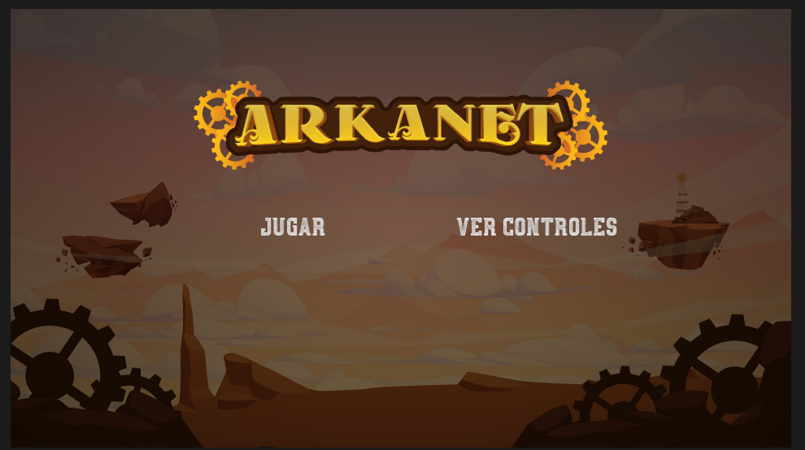
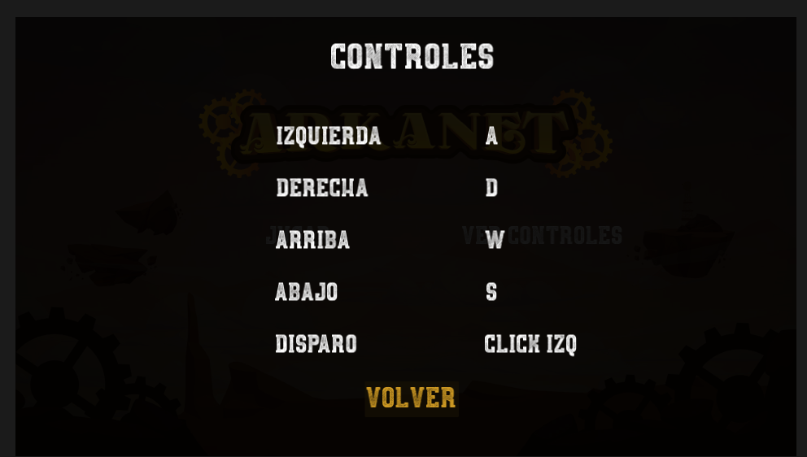
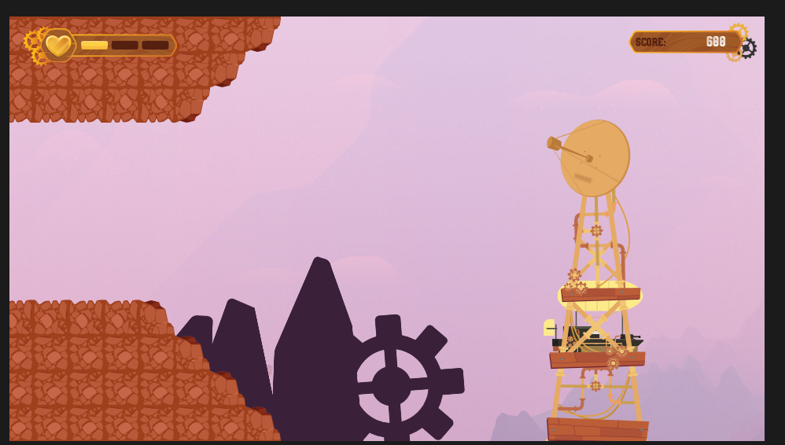
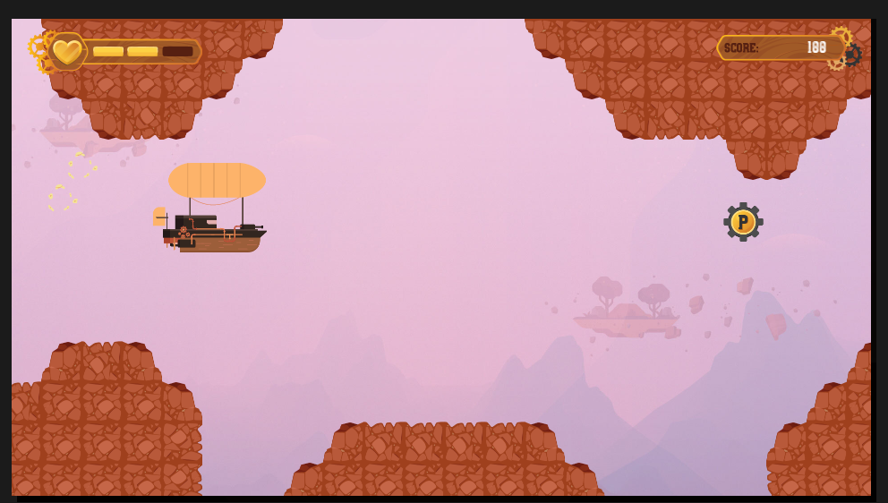
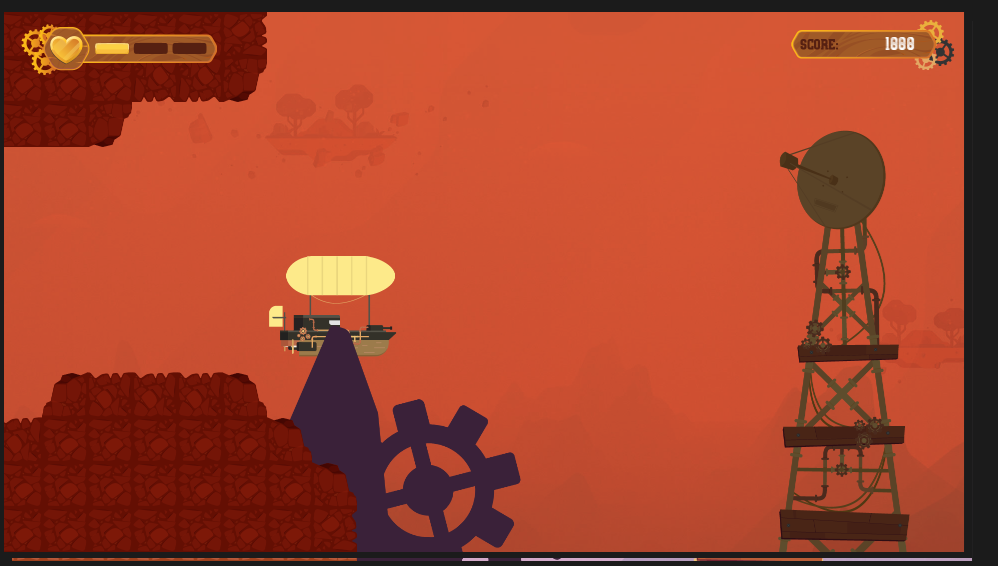
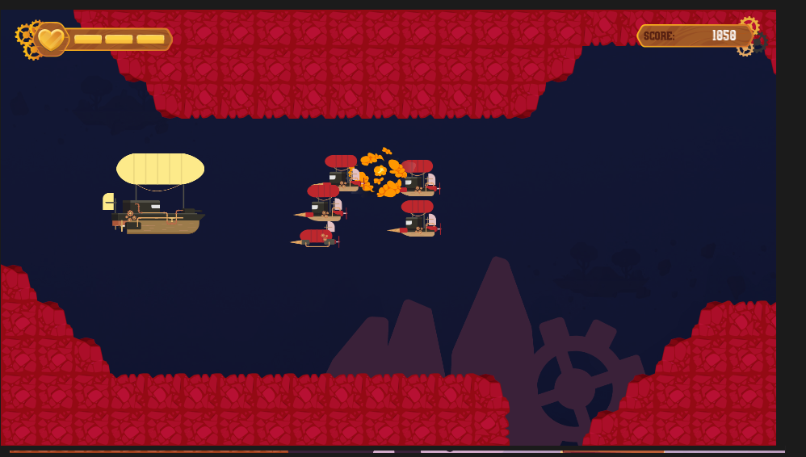

# 2D Shoot 'Em Up - Godot 4

## 1. Description

A 2D shoot 'em up game developed in Godot 4. This project is an adaptation of a Platzi tutorial originally built for Godot 3. While the graphical assets and sound effects are sourced from the original tutorial, the entire codebase has been substantially rewritten and adapted by me to work with Godot 4.

The game features an initial main menu with options to play and view the controls. It includes three distinct levels with different visual themes: day, sunset, and night. The player controls a character with three lives and earns points by shooting enemies.

## 2. Technologies Used

*   **Engine:** Godot 4
*   **Programming Language:** GDScript (`.gd` files)
*   **Assets:** 2D Sprites (PNG, JPG), Audio files (BGM and SFX)
*   **Configuration:** Godot Export Presets, Audio Bus Layout

## 3. Project Structure

```
res://
├── Assets/
│   ├── disparo/          # Projectiles and power-up sprites
│   ├── enemigos/         # Enemy and explosion sprites
│   ├── fondo/            # Background elements and tilesets
│   ├── fonts/            # Font files and presets
│   ├── hud/              # Heads-up display elements (health bar, score table)
│   ├── pantalla_principal/ # Main menu background and logo
│   └── personaje/        # Player character sprites
├── Scenes/
│   ├── DiproEspecial.tscn
│   ├── Disparo.tscn
│   ├── Enemigo.tscn
│   ├── EnemigoDirigido.tscn
│   ├── GrupoEnemigo2.tscn
│   ├── GrupoEnemigos.tscn
│   ├── Meta.tscn
│   ├── Monte.tscn
│   ├── Nivel1.tscn
│   ├── Nivel2.tscn
│   ├── Nivel3.tscn
│   ├── PantallaPrincipal.tscn
│   ├── Personaje.tscn
│   ├── PowerUp.tscn
│   ├── TemplateNivel.tscn
│   └── VerControles.tscn
├── Scripts/
│   ├── Camera_2d.gd
│   ├── Disparo.gd
│   ├── DisparoEspecial.gd
│   ├── Enemigo.gd
│   ├── EnemigoDirigido.gd
│   ├── Global.gd
│   ├── GrupoEnemigos.gd
│   ├── Meta.gd
│   ├── Monte.gd
│   ├── PantallaPrincipal.gd
│   ├── Personaje.gd
│   └── PowerUp.gd
├── Sounds/
│   ├── bgm/              # Background music
│   └── sfx/              # Sound effects
├── default_bus_layout.tres
├── export_presets.cfg
├── icon-arkanet.png
├── icon.svg
└── README.md
```
## 4. Technical Explanation

The project follows a modular scene-based architecture typical of Godot. 

*   **Game Flow & Menus:** The entry point is `PantallaPrincipal.tscn`, which handles the main menu logic via `PantallaPrincipal.gd`. From here, the player can navigate to `VerControles.tscn` to view the controls or start the game.
*   **Level Design:** The game consists of three levels (`Nivel1.tscn`, `Nivel2.tscn`, `Nivel3.tscn`) representing day, sunset, and night. These levels likely inherit from a common `TemplateNivel.tscn` to reuse core gameplay logic and level structure.
*   **Gameplay Entities:** 
    *   The player is controlled by `Personaje.gd`.
    *   Shooting mechanics are handled by `Disparo.gd` (standard shot) and `DisparoEspecial.gd` (special shot).
    *   Enemies are managed through `Enemigo.gd`, `EnemigoDirigido.gd`, and group spawners like `GrupoEnemigos.gd`.
    *   Additional interactive elements include `PowerUp.gd`, `Meta.gd` (goal), and `Monte.gd` (obstacle/environment).
*   **Game State:** `Global.gd` acts as a singleton (Autoload) to manage global game state, such as the player's three lives and the current score.
*   **Audio:** Audio routing is configured via `default_bus_layout.tres`, separating background music (BGM) and sound effects (SFX).
*   **Godot 4 Adaptation:** The original tutorial's Godot 3 code was refactored to leverage Godot 4 features, including updated node types, GDScript 2.0 syntax, and modern signal connections.

## 5. Evidence
*   **Playable Game:**
    [Play Arkanet on itch.io](https://osthorp1603-spec.itch.io/arkanet)










